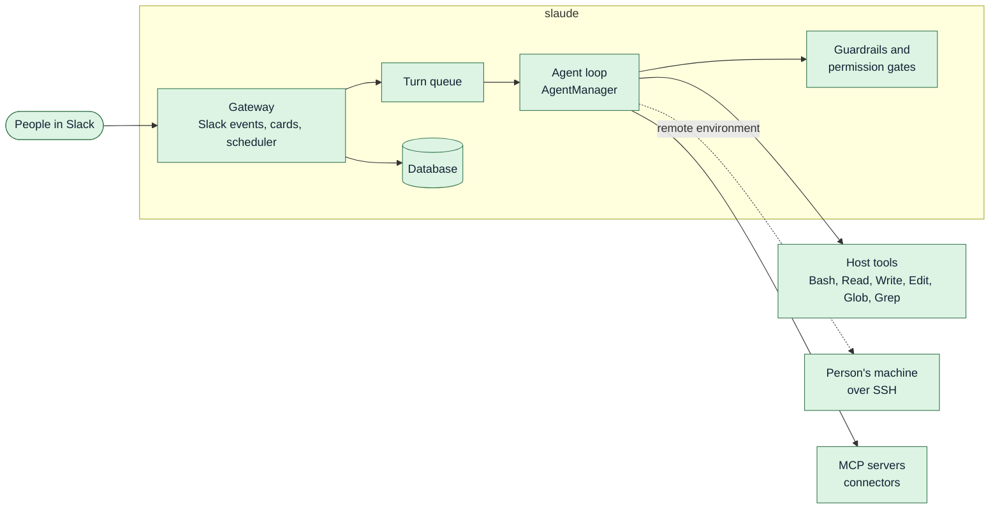
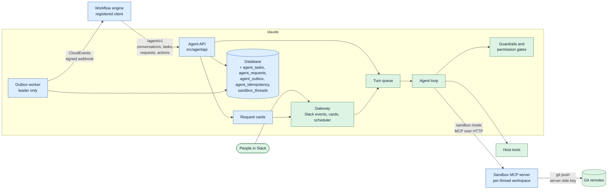
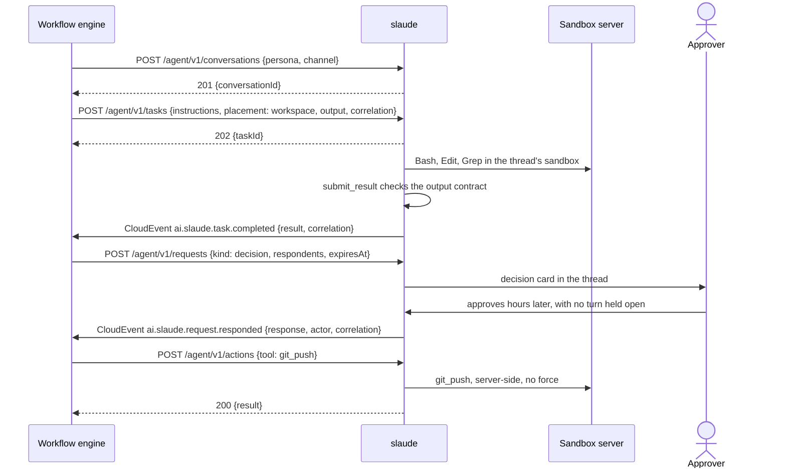

# TRD: Agent host API and sandbox mode

| Metadata | Value |
| --- | --- |
| Status | Proposal for review. Pull requests 1 and 2 (sandbox mode, Helm charts) are built on branches; nothing is merged to `main`. The agent API (pull requests 3 to 7) is not built. |
| Components | slaude gateway, agent loop, database; a separate sandbox MCP server |
| First client | A workflow engine that runs multi-stage, human-approved work (Temporal-based) |
| Last updated | 25 November 2026 |
| Delivery | Seven pull requests after this one, each released as a release candidate (section 9) |

## 1. Background

slaude runs a persona as a Slack teammate. Every turn starts from Slack (a message, a mention, a slash command, a card click) or from slaude itself (cron, heartbeat, promise checks). The agent's file and shell tools run on the agent host, or on a person's own machine through a remote environment.

Some teams want a persona to take part in a longer process that another system owns: a workflow engine that moves a ticket through planning, implementation and review, asks a person to approve each stage, and survives restarts and process changes while runs are in flight. The engine owns the process. slaude owns the conversation, the agent, the cards and the tools.

## 2. Problem statement

- **No way in for another system.** An external engine cannot ask a persona to do work, ask a person for a decision, or run a tool. The options today are to impersonate a Slack user or to add a callback endpoint specific to one engine.
- **No way out.** slaude cannot tell an engine that work finished or that a person answered. Approval cards decide in-turn tool calls only, and they hold the turn for at most an hour.
- **Work runs on the agent host.** A coding task clones, builds and runs tests next to the gateway's credentials. Remote environments move the work to a person's machine over SSH, which suits a person and does not suit an unattended process.
- **No packaged deployment.** `deploy/k8s-scale/` is a set of plain manifests. Every operator copies and edits them, and nothing deploys a sandbox server beside slaude.

## 3. Objectives

- Offer one generic, versioned HTTP API, `/agent/v1`, that any orchestrator can use without slaude learning its process model.
- Report results and answers asynchronously, as CloudEvents 1.0 over signed webhooks, delivered at least once.
- Let a thread run its file and shell tools in an isolated sandbox that holds no credential, with git pushes performed server-side under policy.
- Ship Helm charts for slaude and the sandbox server, kept in parity with `deploy/k8s-scale/`.

Out of scope:

- A workflow engine inside slaude. slaude stores no process definition, stage or run. It stores an opaque `correlation` object per resource and returns it unchanged.
- A message broker or an event stream endpoint.
- New card types that need Slack modals (forms, free-text questions). The first version has decision and choice requests.
- Changes to how approvers are resolved. Requests reuse grants (`manager`, `approver`, `member`) and approver categories.

## 4. High-level architecture

### 4.1 Current

Every turn begins in Slack or in slaude's own scheduler. Tools run on the host or on a person's machine.



- Inbound: Slack events, slash commands, card actions, cron and heartbeat.
- Outbound: Slack messages and cards only.
- HTTP endpoints serve nodes (`/v1`), the deploy pipeline (`/deploy`), the panel and the portal. None is meant for an external orchestrator.

### 4.2 Proposed

An orchestrator becomes a registered client of `/agent/v1`. slaude turns its calls into turns, cards and tool calls, and reports back through an outbox. A thread in sandbox mode runs its tools on a sandbox MCP server.



| Aspect | Current | Proposed |
| --- | --- | --- |
| Who starts a turn | Slack or slaude's scheduler | Also a registered client, through a task |
| Asking a person | In-turn approval card, held for at most an hour | Also a stored request, answered at any time before its expiry |
| Reporting a result | A Slack message | Also a CloudEvent to the client, written to an outbox in the same transaction |
| Running a tool without a model | Not possible | An action, under the same permission policy and audit as a model's tool call |
| Where file and shell tools run | Host, or a person's machine | Also a per-thread sandbox; the host holds no repository key |
| Process state | None | None. The client's `correlation` is stored and returned, never read |
| Deployment | Plain manifests in `deploy/k8s-scale/` | Also Helm charts for slaude and the sandbox server |

### 4.3 One stage of a process, end to end



The engine decides when a card is due and whether the approver is acceptable. slaude renders the card, checks that the person who clicked is an allowed respondent, and reports who answered with the roles it resolved for them.

## 5. Agent host API

An API is generic when a caller that knows nothing of any particular process can use it. No field names a stage, a pipeline or a ticket.

### 5.1 Resources

| Resource | Calls | Answer |
| --- | --- | --- |
| Conversation | `POST /agent/v1/conversations`, `GET /conversations/:id` | Immediate. Binds a persona, a channel and an optional thread. The thread is bound when the first message is posted. |
| Capabilities | `GET /agent/v1/personas/:id/capabilities` | Immediate. Fresh context, sandbox, allowed actions, connectors. |
| Task | `POST /agent/v1/tasks`, `GET /tasks/:id`, `POST /tasks/:id/cancel` | `202 {taskId}`. The result arrives as an event. |
| Request | `POST /agent/v1/requests`, `GET /requests/:id`, `POST /requests/:id/remind`, `POST /requests/:id/cancel` | `202 {requestId}`. The answer arrives as an event. |
| Action | `POST /agent/v1/actions` | `200` with the tool result. |

Calls that involve a model or a person complete asynchronously, because a turn takes minutes and a person may answer days later. Everything else answers at once.

### 5.2 Clients

Each caller is a registered client, one file per client in `$SLAUDE_HOME/api-clients/<name>.yaml`:

```yaml
name: process-engine
token: { env: AGENT_API_PROCESS_ENGINE_TOKEN }
personas: [support-bot]
channels: ["slack:channel:<channel-id>"]
actions: [git_push]
events:
  url: https://engine.example.internal/slaude/events
  secret: { env: AGENT_API_PROCESS_ENGINE_SIGNING_SECRET }
  notifyHosts: [engine.example.internal]
```

- The client is the authorisation boundary: the personas, channels and action tools it may use.
- A client sees only the resources it created.
- A client file gives its bearer token as `token: { env: NAME }` or as `tokenSha256`, so the plaintext need not reach slaude. Bearer tokens are compared in constant time. An unknown or wrong token gets `401`, a resource of another client gets `404`.
- Every create call takes an `Idempotency-Key`. A repeat returns the first response.
- `/agent/v1` is mounted on the `gateway` role only, never on a node. On `mono` the agent child runs as the same OS user as the process that holds the clients' signing secrets, so it could sign a forged event; `mono` serves the API only with `SLAUDE_AGENT_API_ON_MONO=1`, for development. This follows the rule for `/deploy` in `src/health.ts`.

### 5.3 Tasks

A task asks the persona to do work in a conversation.

- `context: thread` runs the task as a turn in the conversation's thread, through the turn queue, with a new turn origin `api`. The turn is its own job: it never coalesces with a person's message waiting in the same thread. `api` is not an interactive origin, so a permission card in a task turn can be decided only by an approver or manager.
- A task finishes through the path a background turn already uses (the ledger run a node finishes with the turn's outcome), so there is one completion path for turns that no person started.
- `context: fresh` runs a locked-down query built like a background run: no tools unless allowed, no setting sources, a scrubbed environment.
- `placement: workspace` runs the task in sandbox mode (section 6).
- `output` declares a JSON Schema and an optional validation URL. A `submit_result` tool checks the result against the schema, then posts it to the validation URL through `outboundFetch`. A `422 {problems}` answer goes back to the model in the same turn.
- `deadline` bounds the task. A task past its deadline fails with `ai.slaude.task.failed`.

A task is a persisted record. After a restart, `GET /tasks/:id` still answers, and a task whose turn was lost is failed explicitly rather than left running.

### 5.4 Requests

A request asks one or more people for an answer and outlives any turn.

- Kinds: `decision` (approve or reject, with an optional note) and `choice` (one of the listed options).
- Respondents: Slack user ids, grant roles (`manager`, `approver`, `member`), or an approver category, resolved with `src/access/role.ts` and `decideApprovers`. A click by anyone else is refused on the card.
- The answer records the responder's user id and the roles slaude resolved at click time. slaude attests; the client decides whether that is enough.
- Every request has an expiry (default 3 days, at most 30). A leader-only sweep expires overdue requests once each through `claimSlot` and edits the card.
- `remind` reposts a nudge in the thread. `cancel` closes the card.
- Requests do not use `pending_gates`. Its `kind` constraint and one-hour lifetime fit a held tool call, not a question that may wait for days.

### 5.5 Actions

An action runs one named tool with given arguments and no model, for example `git_push` after an approval.

- The client's action allowlist is checked first.
- The call then goes through the same permission policy, owner guardrails and audit as a model's tool call, acting as the persona.
- An action never posts a card. When an owner guardrail with `action: approve` matches, the call is refused with `409`; the client opens a request, and retries the action once it is answered.
- In a sandbox thread, `git_push` is called on the sandbox server directly, with the same bearer and session header the turn uses.

### 5.6 Events

- Each event is written to `agent_outbox` in the same transaction as the state change that caused it.
- A leader-only worker delivers it as a CloudEvents 1.0 message in structured mode (`Content-Type: application/cloudevents+json`).
- Types: `ai.slaude.task.completed`, `ai.slaude.task.failed`, `ai.slaude.request.responded`, `ai.slaude.request.expired`, and `ai.slaude.trigger.invoked` (section 5.7).
- The CloudEvents `id` is the deduplication key; `subject` is the task or request id; `data` carries the result and the client's `correlation`.
- Delivery is at least once, retried with exponential backoff, and signed with HMAC-SHA256 of the body in a `webhook-signature` header.
- The target is the client's event URL, or the create call's `notify.url` when its host is in `notifyHosts`. A `404` or `410` from a notify URL ends delivery.
- All delivery goes through `outboundFetch`, so the outbound policy applies.
- There is no event stream. A client that missed events reads `GET /tasks/:id` or `GET /requests/:id`.

### 5.7 Triggers

A configured slash command dispatches `{conversationId, actor, text}` to a client as an `ai.slaude.trigger.invoked` event through the outbox, so `/<command>` in Slack can start a process in an engine without slaude knowing the process.

## 6. Sandbox mode

A thread can run its file and shell tools on a sandbox MCP server instead of the agent host.

- `SLAUDE_SANDBOX_MCP_URL` and a bearer token point slaude at the server.
- In sandbox mode, `Bash`, `Read`, `Write`, `Edit`, `Glob` and `Grep` are served by the server, keyed by an `X-Sandbox-Session` header, and the local built-ins are denied. This reuses `REMOTE_TOOL_ALIASES`, `makeRemoteCanUseTool` and `denyLocalBuiltins` from `src/remote/`, with an HTTP MCP transport beside the SSH one.
- A thread enters sandbox mode with `/sandbox on`, the `enter_sandbox` tool, or a task with `placement: workspace`. The choice is stored in `sandbox_threads` and is part of the session fingerprint, so a change starts a fresh SDK session.
- `git_push` and `git_fetch` run on the server with the server's key, only to configured remotes, never with force. Pushed branch names must match `SLAUDE_GIT_PUSH_BRANCH_PATTERN`. Each push goes through the permission gate.
- The sandbox holds no credential, and the agent host holds no repository key.

The sandbox server is a separate service with local, Docker, Kubernetes and VPS backends. This document covers slaude's client side and the server's deployment chart.

## 7. Deployment

`deploy/helm/` gains two charts. `deploy/k8s-scale/` stays the reference for the production shape.

- **`deploy/helm/slaude`**, with `topology: mono | scale`.
  - `mono`: one Deployment and a PVC for `$SLAUDE_HOME`.
  - `scale`: gateway and node Deployments, ingress, optional KEDA or HPA autoscaling and the optional egress NetworkPolicy, equivalent to `deploy/k8s-scale/*.yaml`.
  - Secrets are referenced by name, never created from values.
  - `sandbox.mcpUrl`, `agentApi.enabled` and `agentApi.clientsConfigMap` are values. `values.schema.json` validates them.
- **`deploy/helm/sandbox`**: the sandbox server and, for the Kubernetes backend, a ServiceAccount with a Role limited to sandbox pods in one namespace, mirror storage, and optional NetworkPolicies isolating sandbox pods.
- `tests/deploy/helm-parity.test.ts` renders the `scale` topology and compares it with `deploy/k8s-scale/`. It skips with a message when `helm` is not installed.
- `deploy/k8s-local/up.sh --helm` installs the chart locally so `verify-turns.sh` runs unchanged.
- Charts are packaged as OCI artifacts on the same tag as the image.

## 8. Data model

Every table has a Postgres migration and a matching sqlite schema, checked by `tests/db/schema-drift.test.ts`. Migration numbers on the branch stack: `0055` sandbox threads (`main` took `0054`), `0056` agent API base (idempotency, conversations), `0057` tasks, `0058` requests, `0059` outbox. They are renumbered on rebase if `main` gains a migration first.

| Table | Columns (summary) | Pull request |
| --- | --- | --- |
| `sandbox_threads` | channel, thread, created by, created at | 1 |
| `agent_idempotency` | client, key, response hash, resource id, created at | 3 |
| `agent_tasks` | id, client, conversation, status, context, placement, output contract, result, correlation, deadline | 4 |
| `agent_requests` | id, client, conversation, kind, title, content, options, respondents, status, response, responder, expiry, correlation | 5 |
| `agent_outbox` | event id, client, type, subject, payload, target, attempts, next attempt, delivered at | 6 |

Conversations are stored on `agent_tasks` and `agent_requests` as a persona, channel and thread, with a small `agent_conversations` table added in pull request 3.

## 9. Delivery

Each pull request is usable without the ones after it, and each ships as a release candidate because it touches the schema or the agent loop.

| # | Pull request | Depends on |
| --- | --- | --- |
| 0 | This document | |
| 1 | Sandbox mode | |
| 2 | Helm charts for slaude and the sandbox server | 1 |
| 3 | `/agent/v1` foundation: clients, conversations, capabilities, idempotency, turn origin `api` | |
| 4 | Tasks and `submit_result` | 3 (and 1 for `placement: workspace`) |
| 5 | Requests: table, cards, respondents, expiry | 3 |
| 6 | Outbox and CloudEvents webhooks | 4, 5 |
| 7 | Actions, trigger dispatch, `docs/agent-api/openapi.yaml` with a route drift test | 6 |

## 10. Open questions

1. Should `/agent/v1` ship behind a feature flag until a second client exists?
2. Is a file per client under `$SLAUDE_HOME/api-clients/` the right registry, or should clients be console-managed resources like guardrails?
3. Should sandbox mode become one more environment kind beside SSH remote environments, rather than its own switch?
4. Should requests support `form` and free-text answers (Slack modals) in the first version?
5. Is a gateway-only mount, with `mono` behind a development flag, acceptable, or must `mono` serve the API by default? The alternative is to run the agent child under a separate OS user on `mono`.
6. Should an action refused by an `approve` guardrail post a card itself, rather than answer `409` and leave the request to the client?

## Appendix A. Payload sketches

The OpenAPI document added in pull request 7 is the contract. These sketches show the shape.

```ts
// POST /agent/v1/conversations
{ persona: "support-bot", channel: "slack:channel:<id>", thread?: "<ts>", title?: "…" }
// -> 201 { conversationId, thread?: "<ts>" }

// POST /agent/v1/tasks                Idempotency-Key: <client-chosen>
{
  conversationId, instructions: "…",
  context: "thread" | "fresh",
  placement: { kind: "host" } | { kind: "workspace", profile?: "code" },
  tools?: { allow?: string[] },
  output?: { schema?: JSONSchema, validateUrl?: "https://engine…/validate", name?: "plan" },
  deadline?: "PT30M",
  notify?: { url: "https://engine…/resume/8812" },
  correlation?: { any: "opaque" }
}
// -> 202 { taskId }

// POST /agent/v1/requests             Idempotency-Key: <client-chosen>
{
  conversationId, kind: "decision" | "choice",
  title: "…", show?: { markdown?: "…", url?: "…" }, options?: string[],
  respondents: { users?: string[], roles?: ("manager" | "approver" | "member")[], category?: string },
  expiresAt?: "…", notify?: { url }, correlation?
}
// -> 202 { requestId }

// POST /agent/v1/actions              Idempotency-Key: <client-chosen>
{ conversationId?, persona: "support-bot", tool: "git_push", args: { branch: "…" } }
// -> 200 { ok: true, result } | 403 { error: "tool not allowed for this client" }

// POST <event URL or notify.url>
// Content-Type: application/cloudevents+json   webhook-signature: v1,<hex hmac-sha256 of body>
{ specversion: "1.0", id: "evt_…", source: "https://<slaude host>/agent/v1",
  type: "ai.slaude.request.responded", subject: "req_…", time: "…",
  datacontenttype: "application/json",
  data: { requestId, conversationId,
          response: { decision?: "approve" | "reject", option?: "…", note?: "…" },
          actor: { userId: "<slack user id>", roles: ["approver"] },
          correlation } }
```
